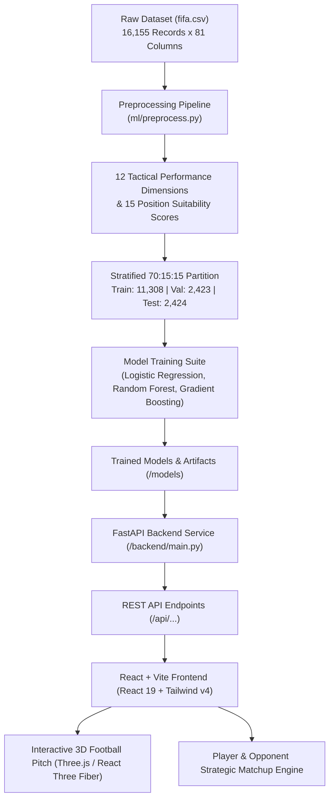
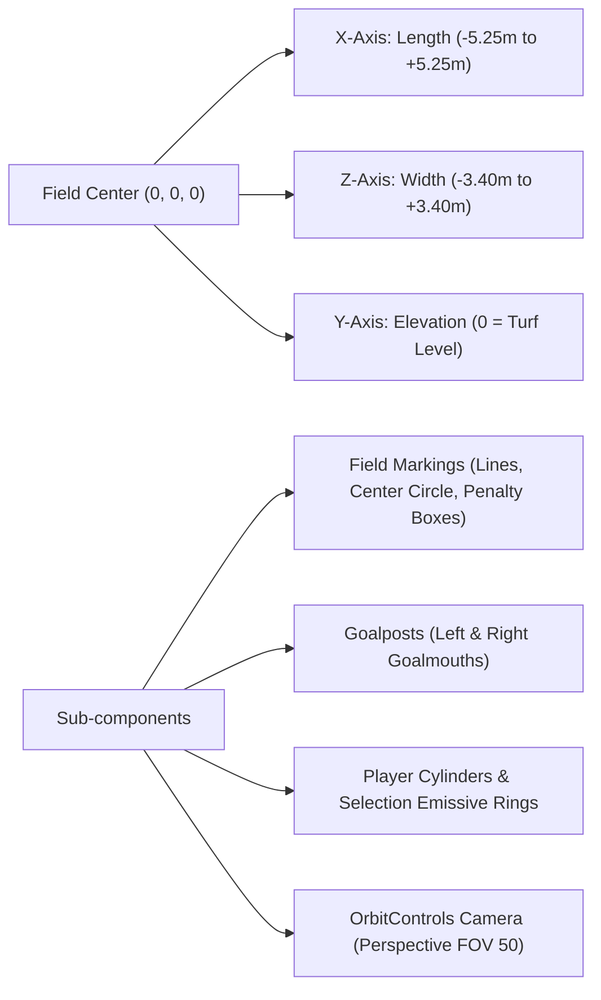

# TACTIX AI — System Architecture & Data Flow

## 1. High-Level Architecture Overview



---

## 2. Recommendation Engine Scoring Pipeline

```mermaid
flowchart LR
    P["Selected Player Profile"] --> ML["ML Classifier<br>(Trained Champion Model)"]
    P --> SUIT["Heuristic Suitability Engine<br>(Domain Weighted Heuristics)"]
    P --> OPP["Opponent Lineup<br>(Direct 1v1 Attribute Differentials)"]

    ML -->|ML Probability (0-100%)| COMB["Composite Score Aggregator<br>FinalScore = alpha*ML + beta*Suit + gamma*Match"]
    SUIT -->|Suitability Score (0-100)| COMB
    OPP -->|Matchup Advantage Score (0-100)| COMB

    COMB --> RANK["Ranked Tactical Role Recommendations<br>with Positive & Negative Drivers"]
```

---

## 3. 3D Football Pitch Coordinate System


